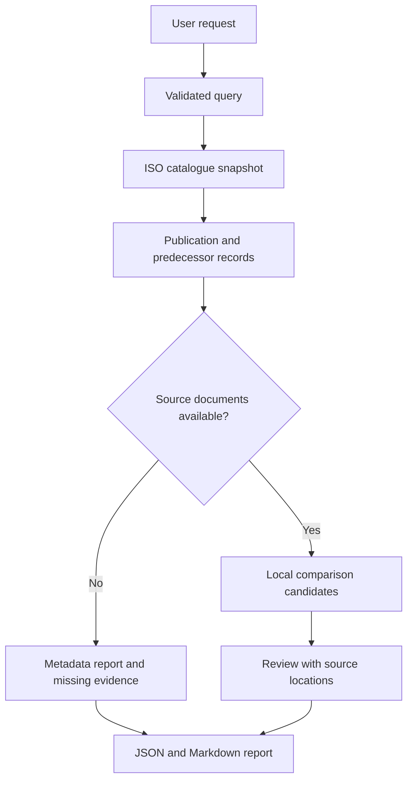

# Standards Update Agent — implementation and handoff

Date: 19 November 2026 (Asia/Hong_Kong)

Baseline reviewed: `WONG1357/related-regulation-content-update`, commit
`b8fb369703e07bb01bdee792ec454805b7994507`.

## 1. Goal and current delivery

The user wants an agent that finds which international standards were published or
updated during the previous year or another requested interval, identifies their
previous versions, and explains the differences between versions.

This increment provides a runnable **ISO publication-discovery and comparison
evidence workflow**. The Python core can be exposed as tools to a future OpenAI,
Microsoft or AWS agent. The independent Streamlit application also works directly.
It is a working prototype with explicit limitations, not a validated regulatory
decision system.

The workflow separates two questions:

1. **Was a new publication released during the requested interval?** Answer from
   official catalogue metadata, publication dates and publication IDs.
2. **Exactly what changed in its content?** Answer only from the identified source
   documents and available comparison evidence. A catalogue abstract does not
   establish a complete clause comparison.

The new entry point does not require internal QMS files. Once the difference
evidence is reviewed, a future integration can pass it to the existing controlled
document impact workflow.

### Implemented

| Capability | Current behavior |
| --- | --- |
| Official discovery | Downloads and validates ISO Open Data JSONL; source hash and acquisition information accompany results |
| Date ranges | Inclusive custom dates; rolling calendar-year/month requests; Hong Kong date default and leap-day clamping |
| Scope | Explicit ISO/ISO/IEC identifiers, explicit series wildcard, ICS prefixes, exact committees, literal keywords or all ISO |
| Version relations | Official `replaces` and `replacedBy` IDs, including multiple/missing predecessors |
| Events | Publication records classified as edition/replacement, amendment, correction, supplement or first edition where supported |
| Local evidence | TXT, DOCX body paragraphs/tables, text-based PDF page extraction |
| Critical differences | Numbers, units, inequality operators, negation, normative modality and logical words remain visible |
| Review state | No automatic assertion of legal or semantic completeness; incomplete extraction remains incomplete |
| Traceability | Query, source snapshot, timestamps, file hashes, clause locations, evidence IDs and comparison attempts |
| User interface | Separate discovery, comparison, and evidence/export tabs |
| Exports | Complete JSON and readable Markdown, with attribution and limitations |
| Optional AI | Translates the user's query into validated filters; standard contents are not sent to the model |

### Not implemented in this increment

- IEC HAPI, ASTM, national/regional adoption catalogues, or legal/regulatory feeds.
- Complete historical dates for confirmations, withdrawals and corrected versions.
- Automatic acquisition of licensed standards, full-text AI interpretation, or OCR.
- Reliable interpretation of diagrams, equations, merged tables, cross references
  and complex split/merge clause mappings.
- Applying an amendment to its base edition or reconstructing consolidated text.
- Automatic comparison against any older company baseline across several revisions.
- Automatic determination of FDA recognition, EU harmonisation, applicable law,
  transition deadlines or which company procedures must change.
- Integration into the existing packaged desktop launcher or a deployed cloud agent.
- Scheduled recurring checks or notifications.

## 2. Why the existing repository needs a separate discovery layer

The baseline application starts with two uploaded documents and a controlled
document source. It already supports Section 3 reference tracing, downstream
amendment suggestions, review controls and exports.

`modules/regulation_amendment_collector.py` also has optional web/ISO search for
already-known old/latest pairs. That is not a complete historical release finder:
it relies on input rows and can treat a search title as a change summary.

Two verified legacy comparison limitations motivated a separate conservative
comparison engine:

| Synthetic input change | Legacy behavior reproduced during review |
| --- | --- |
| `5 mm` → `8 mm` | Classified as editorial and excluded |
| `shall` → `shall not` | Classified as editorial and excluded |
| `should` → `shall` | Classified as editorial and excluded |
| `1 mg` → `1 µg` | Classified as editorial and excluded |
| `< 5 percent` → `> 5 percent` | Classified as unchanged |

These tests use invented requirements, not quoted standards. The old comparison
normalisation discards some meaningful symbols; a high string-similarity threshold
also hides small but material changes. Generic extraction stops at the first
annex, including a normative annex. Filename identity cannot represent an
amendment with both a base-edition year and a supplement year.

The new module preserves every extracted text difference as a candidate, and
marks uncertain structural matching. The existing legacy engine has not been
replaced or declared repaired by this increment. Existing users of `app.py`
continue using that legacy path; the new protections apply to
`standards_updates_app.py` and the new workflow APIs.

## 3. Architecture



The AI planner is optional. It does not decide whether a standard exists, fabricate
publication dates or invent clause changes. A deterministic query validator checks
its output. All catalogue filtering, identity selection and local comparison run
without an LLM.

This makes the reusable agent tools small and reviewable. A future conversational
agent can call discovery, resolve document availability, request missing files,
run comparison and describe evidence. It should not bypass the typed functions or
upgrade a partial result into a complete comparison.

### Files

| File | Responsibility |
| --- | --- |
| `modules/standards_catalogue.py` | Official ISO acquisition, schema validation, identity, filtering, lineage and source provenance |
| `modules/standards_query.py` | Hong Kong date defaults, query schema, English/Chinese request parsing, optional AI planning |
| `prompts/standards_update_query.md` | Bounded query-planner instructions |
| `modules/standards_diff.py` | Local text extraction and conservative text-change evidence |
| `modules/standards_update_workflow.py` | Coordinates discovery and selected comparisons, records attempts and renders exports |
| `modules/standards_update_cli.py` | Command-line access to the workflow |
| `standards_updates_app.py` | Independent Streamlit UI |
| `tests/test_standards_*.py` | Source, date, identity, evidence and integration tests |

## 4. Official source and evidence rules

### ISO Open Data

Official documentation: <https://www.iso.org/open-data.html>.

Dataset: `iso_deliverables_metadata`. ISO publishes machine-readable JSONL, CSV
and Parquet metadata and documents daily updates. Its schema includes `id`,
`reference`, `publicationDate`, `edition`, `supplementType`, `currentStage`,
`icsCode`, `ownerCommittee`, `replaces` and `replacedBy`.

Use the official download link, not a guessed search endpoint:

<https://isopublicstorageprod.blob.core.windows.net/opendata/_latest/iso_deliverables_metadata/json/iso_deliverables_metadata.jsonl>

`publicationDate` is defined by ISO as the date the publication stage, 60.60, was
reached. It is not a website crawl timestamp, release-news date, review date or
regulatory effective date. `currentStage` is the status now; it is not the status
as of a historical query end date.

The dataset is licensed under ODC-By 1.0. Exports include:

> This work is based on the iso_deliverables_metadata dataset from ISO Open Data,
> licensed under ODC Attribution License (ODC-By) v1.0.

Licence: <https://opendatacommons.org/licenses/by/1-0/>.

The downloader validates every record, rejects malformed/duplicate data, bounds
download size and fails explicitly on network errors. It does not report an old
cache as though a failed fresh download succeeded. Imported files are marked
`local_file`: providing an ISO URL does not authenticate their content.

### Publication versus lifecycle events

| Item | Meaning for this workflow |
| --- | --- |
| New edition/replacement publication | A published item linked to predecessor IDs; preserve every predecessor |
| Amendment | Partial change associated with a base edition; cannot be treated as an entire new edition |
| Corrigendum | Correction; do not relabel the base publication as a new edition |
| First edition | No supplied predecessor and edition 1; still a new publication rather than a known revision |
| Missing predecessor | Unknown lineage, not proof that earlier editions do not exist |
| Confirmed | Existing edition confirmed; not a new edition publication |
| To be revised / draft | Development activity; not a published successor |
| Withdrawn | Current lifecycle state; retain a publication if its original publication date is in scope |

Official stage definitions:
<https://www.iso.org/stage-codes.html>.

An existing edition can be at stage 90.92 or 90.93 today while its publication
event remains relevant to the requested interval. Therefore, never restrict
historical discovery to `currentStage == 6060`.

### Historical completeness

The current Open Data snapshot is useful for publication discovery, but it is not
an event-sourced database. A date filter cannot recover every historical event
that is absent from the snapshot. The actual snapshot inspected contained
withdrawn records; this does not prove that every historical record is present.

ISO Update archives provide published, confirmed, withdrawn and draft activity
for specified periods: <https://www.iso.org/iso-update.html>. The November 2026
issue covers 1 October to 1 November, so that monthly issue alone does not cover
the rest of November. Archive integration is future work and must use suitable
content rights. Saved catalogue snapshots support prospective comparisons, but
do not create missing past history retroactively.

Always distinguish:

- A successful search with zero matching records in the inspected snapshot.
- A source acquisition or validation failure.
- A publication found but its predecessor unavailable.
- A publication found but content differences not yet established.

### Full-text availability and permissions

ISO Open Data and ISO standard full text have different terms. ISO's current
copyright notice specifically exempts Open Data from its default restriction on
using ISO content with AI. Purchasing a PDF should not be represented as proof
that AI processing rights have been granted.

Source: <https://www.iso.org/copyright.html>.

The implemented comparison path makes no model calls and does not acquire full
texts. Use supplied documents under the organisation's applicable rights. Before
adding cloud AI analysis, obtain and record permission appropriate to that use.
Source material should not be committed to this public repository.

## 5. Query semantics and examples

The default previous-year interval uses the Hong Kong date and one calendar year.
For 19 November 2026 it is **2025-11-19 through 2026-11-19**, inclusive. This is
explicitly different from calendar year 2025. A 29 February endpoint clamps the
previous-year starting date to 28 February when necessary.

All identifiers retain their issuer/type/part. `ISO 10993-1` and `ISO 10993-6`
are distinct. `ISO 10993-*` deliberately includes the series. `ISO 10993` alone
does not silently expand into all parts. ISO/IEC and national adoptions are not
silently collapsed into ISO.

Filter values within one field are ORed; different fields are ANDed. For example,
two standards mean either standard, but adding an ICS filter narrows those
results. An exact committee filter does not automatically expand into every
subcommittee.

Supported offline requests include:

```text
查過去一年 ISO 13485、ISO 14971、ISO 10993-* 的更新
Find ISO/IEC 27001 updates in the past 6 months
All ISO from 2025-01-01 to 2025-12-31 ICS 11.040
ISO/TC 210 keyword: "medical devices"
```

The date controls accept any valid historical custom interval. Unsupported natural
date phrasings are rejected with a request to use exact dates. The optional AI
planner is deliberately limited; it cannot invent ICS codes, broaden a watchlist
or supply imagined publication findings. Chinese topic phrases are not
automatically translated into an authoritative taxonomy. Use exact identifiers
or explicit ICS codes when completeness matters.

ICS 11 covers medical and health-care technology broadly. It is not an exhaustive
definition of standards applicable to this company, and relevant QMS standards
can belong to other ICS groups. A company-approved watchlist should ultimately
define operational scope.

## 6. Running the implementation

### Streamlit

From the repository root:

```bash
python -m venv .venv
source .venv/bin/activate
pip install -r requirements.txt
streamlit run standards_updates_app.py
```

On Windows, activate with `.venv\Scripts\activate`.

1. Load the official catalogue or explicitly import an ISO-format JSONL snapshot.
2. Set dates and an explicit scope; run discovery.
3. Inspect reference, publication date, event type, predecessor relationships and
   coverage limitations.
4. Select an update and one official complete-edition predecessor.
5. Supply the corresponding old and new documents, verifying the cover and edition.
6. Review changes and source locations; export JSON/Markdown.

No API key is required for those six steps. Optional AI query interpretation
reuses the existing `AI_API_KEY`, `AI_BASE_URL` and `AI_MODEL` environment setup.
Only query text and schema are sent through that path. Live provider behavior
requires a configured key and was not exercised with a paid API in this work.

### CLI

```bash
python -m modules.standards_update_cli \
  --since 2025-11-19 --until 2026-11-19 \
  --standard 'ISO 13485' --standard 'ISO 14971' \
  --standard 'ISO 10993-*'
```

```bash
python -m modules.standards_update_cli \
  --request 'Find ISO/IEC 27001 updates in the past 6 months'
```

```bash
python -m modules.standards_update_cli \
  --snapshot /path/to/iso_deliverables_metadata.jsonl \
  --since 2025-11-19 --until 2026-11-19 --all-iso
```

To compare a selected discovered pair, add all four arguments together:

```text
--update-id <official-new-ID> --predecessor-id <official-old-ID>
--old-file /path/to/old.pdf --new-file /path/to/new.pdf
```

The IDs must be present in the same snapshot and connected by an official
`replaces` relation. A supplement is not accepted as a standalone complete
edition. Multiple predecessors remain visible; comparing one does not establish
coverage of the whole replacement set.

Output defaults to `data/standards/reports/`, which is excluded from Git. Each run
has a unique run ID, while a stable query fingerprint supports comparison of
equivalent requests. Comparison attempt records preserve the source file hashes.

## 7. What a difference result means

| Status | Interpretation |
| --- | --- |
| `metadata_only` / content `not_run` | Publication known; no content comparison performed |
| `review_required` | Differences found in supplied extracted text; review needed |
| `comparison_incomplete` | Failed/partial extraction or known scope gap; any extracted changes remain useful evidence |
| `comparison_rejected` | Inputs contain the same bytes rather than two distinct sources |
| `partial_replacement_set_review` | Several official predecessors exist; individual pair results do not establish a complete consolidated baseline comparison |
| `no_textual_differences_found` | No difference in the extracted scope; does not establish substantive equivalence |

Each candidate includes old/new clause labels, text, source location, matching
method, evidence ID, critical-token categories and `review_required=true`.

The comparator retains annex content, including normative annexes. Unknown
annex roles remain explicit. DOCX paragraphs and table rows are read in order;
PDF locations refer to physical PDF pages and extracted lines, not a claim about
the printed page numbering.

PDF extraction is always marked incomplete in this lightweight implementation:
text extraction alone cannot prove that all figures, equations, complex tables
or reading order were preserved. Scanned PDFs require a later OCR/visual path.
DOCX drawings, equations, automatic numbering, tracked changes and similar
unresolved content also produce partial extraction. No extraction failure is
converted into “no changes”.

Matching is deliberately conservative. A shared clause number is a candidate
correspondence, not proof of semantic equivalence. Unmatched content may reflect
addition, deletion, movement, splitting or merging; the tool leaves that decision
for review. Critical-token detection is useful prioritisation, not an exhaustive
test of whether every wording change is important.

## 8. Real-source smoke-check examples

An official snapshot retrieved on 19 November 2026 contained 81,856 records;
the source's HTTP Last-Modified was 18 November 2026. Its SHA-256 was:

```text
8e84f92f07435b62ed4c803be22ac08b28ba1cb4ee51e72d8db60b2de774c8d5
```

These figures describe the inspected snapshot, not a permanent catalogue count
or a claim of coverage through the end of 19 November.

Examples confirmed against the downloaded metadata and official product pages:

| Publication | Publication event | Implication for 2025-11-19–2026-11-19 |
| --- | --- | --- |
| ISO 9000:2026 | 2026-05-27 | Included; replaces ISO 9000:2015 |
| ISO 9001:2026 | 2026-09-16 | Included; official replacement set includes the old edition and its amendment |
| ISO 10993-6:2026 | 2026-04-15 | Included even though current stage is 90.92 |
| ISO 10993-1:2025 | 2025-11-18 | Excluded by one day; included if the start becomes 2025-11-18 |

Official references:

- <https://www.iso.org/standard/9000>
- <https://www.iso.org/standard/9001>
- <https://www.iso.org/standard/10993-6>
- <https://www.iso.org/standard/10993-1>

These examples verify publication discovery, not clause-level changes. No actual
standard PDFs were provided for a real-document content comparison in this task.
The critical-difference acceptance tests use synthetic, freely authored text.

## 9. Validation and acceptance gates

Run the entire existing suite and the new tests:

```bash
python -m unittest discover tests
python -m py_compile standards_updates_app.py modules/standards_*.py
```

Implementation-session verification: **190 tests passed**, including the existing
suite and the new catalogue, query, comparison, workflow and Streamlit AppTest
checks. Python compilation passed. The final official downloader also completed
a real ISO JSONL fetch and retained its hash-addressed snapshot and provenance.
No paid AI request or real licensed full-text comparison was performed.

Acceptance covers date boundaries/leap years, current review/withdrawal status,
draft exclusion, amendments with different base years, multiple/missing
predecessors, source errors, malformed schema, typed query validation, critical
text changes, annexes, DOCX tables, extraction failures, source-hash agreement,
evidence exports and UI workflow integration.

Before production use, add a review set of authorised real standards with known
changes and measure release recall, incorrect release classifications, missed
material changes, clause-mapping precision and document-extraction coverage.
Passing synthetic tests establishes those invariants; it does not establish
real-world recall or regulatory correctness.

## 10. Recommended next increments

### A. Company watchlist and baseline registry

Import the company-approved standard list with issuer, official publication ID,
exact reference/part, current company baseline, product/process applicability and
document owner. Discovery should work even when no full text is stored. Do not
infer a company's adopted edition merely from the latest catalogue record.

Maintain two comparisons separately: immediate predecessor to new edition, and
company baseline to the relevant new edition. The latter may require multiple
intermediate editions and amendments.

### B. Content extraction and licensed comparison

Add authorised document inventory, extraction quality measures, OCR with page
images, structured tables/equations and complete evidence locators. Prefer
publisher-provided exact-version redlines or correspondence tables when usable;
verify their coverage instead of assuming they are exhaustive.

Use deterministic text differences to surface every changed requirement unit.
Then an authorised AI reviewer can explain obligation, threshold, test-method,
scope, documentation or normative-reference changes with cited old/new evidence.
Do not discard a change because most of its text is unchanged.

### C. IEC connector

IEC officially documents HAPI Publications and Projects APIs with bearer
authentication and pagination. Access entitlement must be configured; this repo
does not include a working IEC connection.

- <https://knowledge.iec.ch/hapi-api-reference>
- <https://knowledge.iec.ch/hapi-faq-overview-documentation-access-and-data-refresh-details>
- <https://knowledge.iec.ch/hapi-faq-understanding-publications-api-and-publication-statuses>

IEC status labels distinguish published, revised, replaced and withdrawn. Do not
map a broad Webstore “Withdrawn” label directly to a single lifecycle event.
Implement provider adapters into the same publication/event/relationship model,
and report coverage for each provider independently.

### D. Historical events and regulatory applicability

Preserve dated snapshots prospectively and add appropriately licensed historical
event sources. Record publication, confirmation, withdrawal, recognition,
harmonisation and transition events separately. Do not derive event dates from
the current status or infer jurisdictional applicability from ISO publication.

### E. Agent deployment and downstream QMS integration

Once the desired host is chosen, expose the Python functions as narrow tools:
discover publications, retrieve catalogue identity, resolve authorised documents,
compare supplied versions, retrieve evidence and export a review report.

Use a bounded workflow with clear stop states: missing source, uncertain lineage,
missing document, incomplete extraction, comparison ready for review. The agent
can request the missing item while reporting the facts already established.

Connect reviewed evidence to the existing reference graph and amendment review
tools only after identity and content checks. A successful search result is not
permission to change controlled files. The existing QA/RA review flow remains the
place to decide and approve document revisions.

## 11. Decisions still needed for deployment

These do not block the provided ISO prototype:

1. Approved company watchlist or classification scope.
2. Which publishers beyond ISO should be connected, and their available access.
3. Availability and permitted processing of old/new full texts.
4. Local desktop/Streamlit versus OpenAI, Microsoft or AWS orchestration.
5. Whether the operational baseline is the immediately preceding edition or the
   company's own adopted edition.

The code is structured so these choices can be made without rewriting the
publication identity, date filtering or evidence model.
